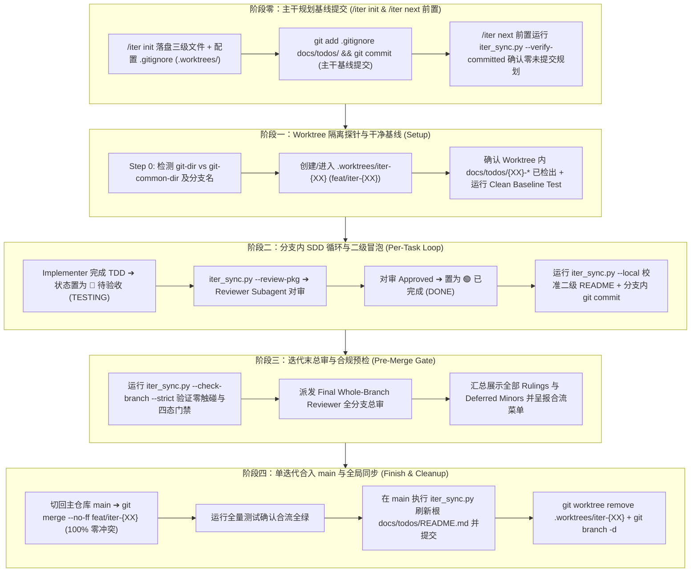

# 🛡️ Worktree 并行敏捷迭代、Zero-Root-Touch 与单迭代合流契约 (v2.0)

在多迭代演进与高并发工程协作中，[`iteration-manager`](file:///C:/Users/qingyu/.codeg/skills/iteration-manager/SKILL.md) 深度融合了 Superpowers 的 `using-git-worktrees` 与 `finishing-a-development-branch` 最佳实践，确立了 **「主干规划提交基线 + `1 Worktree = 1 Iteration` + `Zero-Root-Touch` 目录级物理隔离 + 单迭代主干合流」** 的全生命周期契约。

---

## 证据持久化与只读门禁

新卡遵守 [task_card_schema.md](task_card_schema.md)：实现提交C含代码、测试与原始输出，独立Reviewer核对C及冻结规格；APPROVED后登记JSON收据、状态和报告，提交D，再对干净候选运行严格门禁。head_sha绑定C，不改成D。仅状态/账本登记免重审，代码/规格/原始输出变化必须重审受影响内容。不同type使用各自证据，不为非TDD任务补造RED。

审查包目录通过 `git rev-parse --git-path iter_reviews` 定位，兼容linked worktree的.git文件。临时审查包不代替项目证据目录：清理Worktree前将原始输出、最终报告与收据保留在可检出的证据目录。--check-scope --include-worktree只读检查，已有dirty由主控核对归属，不自动checkout/reset/clean。Git失败、无效引用、缺规格/证据或未知状态均不放行。

## 📌 1. 核心架构原则：为什么采用 `1 Worktree = 1 Iteration` 与 `Zero-Root-Touch`？

### 1.1 前置铁律：Worktree 创建前的「规划基线提交门禁 (Pre-Worktree Commit Gate)」
- **Git Worktree 的底层机制约束**：`git worktree add .worktrees/iter-{XX} -b feat/iter-{XX} main` 仅会从 `main` 分支的**已提交 Git Commit 树**中检出文件，主工作区中未追踪（Untracked）或未提交（Unstaged/Staged）的 `docs/todos/` 文件**绝对不会自动进入新 Worktree**！
- **双重提交门禁机制**：
  1. **门禁一（`/iter init` 收尾强制提交）**：在主干完成三级文档落盘后，必须立即执行精准暂存与提交：
     `git add .gitignore docs/todos/ && git commit -m "docs(iter): initialize iteration {XX}-{name} todo cards and roadmap"`
     *(注：此处在 `main` 主干上初始化总控与任务卡，不属于分支开发态，完全符合 `Zero-Root-Touch`)*；
  2. **门禁二（`/iter next` & `/iter task` 启动前 `--verify-committed` 兜底检查）**：防止用户在 `/iter init` 后手动微调了任务卡却忘记 Commit，在生成新窗口 Prompt 及执行 `git worktree add` 前，强制运行 `python iter_sync.py --verify-committed`；若发现未提交的 `docs/todos/` 变更，立即补充 Commit 后再拉起 Worktree。

### 1.2 分支与工作区粒度法则：`1 Worktree = 1 Iteration`
- **工作区路径标准**：统一放置于项目根目录下的 `.worktrees/iter-{两位序号}`（如 `.worktrees/iter-02`），必须在 `.gitignore` 中配置忽略 `.worktrees/`；
- **分支命名标准**：统一采用 `feat/iter-{两位序号}-{迭代短名}`（如 `feat/iter-02-user-auth`）；
- **工作区内相对路径准则（防跨目录串写）**：进入 `.worktrees/iter-{XX}` 后，所有子智能体必须读写**当前 Worktree 下的 `docs/todos/{XX}-*/` 文件**，严禁通过指向主仓库原工作区的绝对路径去修改主工作区中的 `docs/todos/` 文件！
- **黄金合流平衡点**：
  1. **子任务级（Per-Task）**：每完成 1 个子任务并通过 Reviewer Subagent 验收后，仅在当前 Worktree 分支内执行 `git commit` 并运行 `iter_sync.py --local` 刷新二级 `docs/todos/{迭代}/README.md`；
  2. **单迭代级（Per-Iteration）**：当该迭代下所有子任务全部 `🟢 已完成` 并通过迭代末全分支总审后，立即将该迭代分支零冲突合入 `main`、运行 `/iter sync` 校准全局看板并销毁该 Worktree。

### 1.3 Zero-Root-Touch 目录级物理隔离原则
**最安全的防冲突机制是不产生任何交叉写集合：**
1. **分支开发态绝对禁止触碰根文档**：在 Worktree 分支内，**严禁以任何形式修改、格式化或提交根目录 `docs/todos/README.md`**；
2. **二级索引为分支唯一自治真源**：`docs/todos/{迭代}/README.md` 承载当前迭代的全部任务状态与完成度，由 `python iter_sync.py --local` 毫秒级幂等维护；
3. **主干统一最终一致性聚合**：迭代分支合入 `main` 主干后，在 `main` 上统一触发 `/iter sync` 刷新根 `docs/todos/README.md`。

---

## 🗂️ 2. Worktree 三级文档读写权限矩阵 (Read/Write Scope Matrix)

| 文件层级与路径 | 读权限 | 写权限 | 行为准则与物理防御机制 |
| :--- | :---: | :---: | :--- |
| **所属迭代目录** `docs/todos/{当前迭代}/*` | 🟢 允许 | 🟢 允许 | **100% 自治真源**：维护本迭代的三级任务卡（含iter:ledger 第7节实证与裁决账本），并通过 `iter_sync.py --local` 自动重算二级 `README.md`。 |
| **外部迭代目录** `docs/todos/{非当前迭代}/*` | 🟢 允许 | 🔴 **严禁** | **跨迭代防污染**：严禁修改其他迭代的任务卡或文档，由 `iter_sync.py --check-branch` 审计拦截。 |
| **总控路线图与看板** `docs/todos/README.md` | 🟢 允许 | 🔴 **严禁** | **Zero-Root-Touch 零触碰红线**：`iter_sync.py` 内置特性分支写入锁，非 `main` 分支调用时自动拒绝修改根 `README.md`。 |

---

## 🔄 3. Worktree 四阶段全生命周期操作规程

### 阶段一：启动期隔离探针与基线验证（融合 `using-git-worktrees`）
1. **确认主干规划已提交**：在创建 Worktree 前，先运行 `python ~/.codeg/skills/iteration-manager/scripts/iter_sync.py --verify-committed`；
2. **检测现有隔离状态（严禁盲目嵌套创建 Worktree）**：
   依次运行 `git rev-parse --git-dir`、`git rev-parse --git-common-dir` 与 `git branch --show-current`（注意排除 `git rev-parse --show-superproject-working-tree` 子模块情形）；
3. **创建或复用 `.worktrees/iter-{XX}`**：
   - 若尚未处于独立 Worktree，先执行 `git check-ignore -q .worktrees` 确认 `.worktrees/` 已被忽略；
   - 执行 `git worktree add .worktrees/iter-{XX} -b feat/iter-{XX}-{slug} main`；
4. **干净基线测试（Verify Clean Baseline）**：
   在开始第 1 个子任务前，必须运行一次项目测试套件，确保工作区基线 100% 绿灯。

### 阶段三 & 四：迭代收尾菜单与合流清理（融合 `finishing-a-development-branch`）
当本迭代所有子任务均已流转为 `🟢 已完成 (DONE)`、通过全分支总审且 `python iter_sync.py --check-branch --strict` 返回 `PASSED` 后，向用户汇总本迭代所有的 `Rulings` 与 `Deferred Minors`，并呈现标准收尾选项：
1. **Option 1（推荐）：本地合入 `main` 主干并触发 `/iter sync` 校准全局看板**
   - 切回主工作区根目录，`git checkout main` ➔ `git merge --no-ff feat/iter-{XX}-{slug}`；
   - 在 `main` 上运行测试套件确认合流结果全绿；
   - 立即运行 `python ~/.codeg/skills/iteration-manager/scripts/iter_sync.py` 刷新根 `docs/todos/README.md` 并提交；
   - 执行 `git worktree remove .worktrees/iter-{XX}` 与 `git branch -d feat/iter-{XX}-{slug}` 完成无痕清理。
2. **Option 2：推送远程分支并创建 Pull Request**（保留 `.worktrees/iter-{XX}` 供后续 PR 迭代）。
3. **Option 3：保持当前 Worktree 与分支原状**（稍后手动处理）。

---

## 🚫 4. 负向约束红线清单 (Negative Constraints Checklist)

- [x] **红线 1**：严禁在 `docs/todos/` 规划文件尚未 `git commit` 入主干前直接执行 `git worktree add`；
- [x] **红线 2**：严禁在 Worktree 分支内通过主仓库原绝对路径跨工作区读写主仓库的 `docs/todos/` 文件；
- [x] **红线 3**：严禁在 Worktree 分支开发态修改、格式化或提交根总控 `docs/todos/README.md`；
- [x] **红线 4**：严禁跳步流转四态（Implementer 只能置为 `🔵 待验收`，唯有 Reviewer Subagent 给出 `Approved` 后才可置为 `🟢 已完成`）；
- [x] **红线 5**：严禁在 `git worktree remove` 报存在未追踪文件时擅自使用 `--force` 强删（必须先向用户展示未提交文件清单并征询处置方式）。
